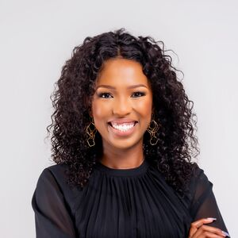
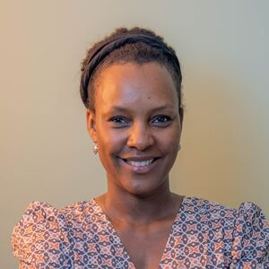
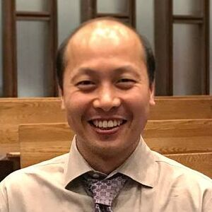
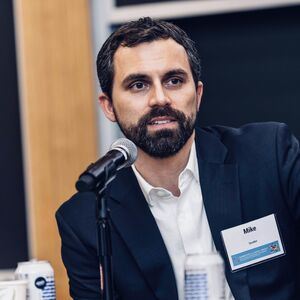
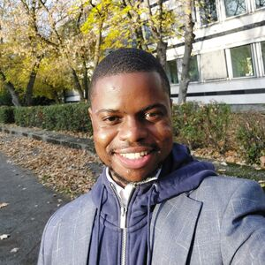
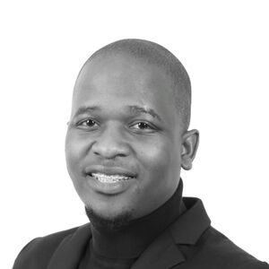
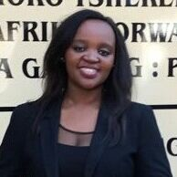
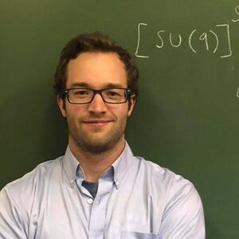

## Advisory Board

Our Advisory Board provides strategic direction, fundraising support, and organizational accountability.

{: .team-photo}
**Nkateko Ndebele** · Co-Chair 
Nkateko, fondly known as Kat, has been involved with the Initiative since her university years. She began as a volunteer and later took on the role of Programme Director alongside Mische Kang. In 2023, she was appointed to the board, further strengthening her commitment to the organization. Now based in Cape Town, Kat is pursuing her MBA at Wits Business School while continuing to champion causes close to her heart: empowering people, advancing health, and improving the livelihoods of underserved communities.
{: #nkateko-ndebele .team-member}

{: .team-photo}
**Cynthia Ayeza** · Co-Chair 
Cynthia has been part of MI since 2011 as a volunteer through her work with Chi Alpha at the University of Pretoria, South Africa, and now as a board member. She currently lives in Boston with her husband, serves youth with IDD, and spares a little time for writing and photography.
{: #cynthia-ayeza .team-member}

{: .team-photo}
**Andrew Chi** · Vice Chair 
Andrew is a computer scientist at Cisco Systems, where he supports detection of malicious behavior in network traffic. He has been involved with the Mamelodi Initiative since 2011 in various capacities, including curriculum development and as a member of the board. Andrew holds a Ph.D. in computer science from the University of North Carolina and enjoys music, math problems, and chess puzzles.
{: #andrew-chi .team-member}

{: .team-photo}
**Michael Silvestri** · Treasurer 
Mike Silvestri is a co-founder of the Mamelodi Initiative and has served as Board Treasurer since its inception in 2010. An impact investor at Social Finance, he brings experience aligning capital with measurable social outcomes and strengthening financial stewardship. Previously, he was a strategy consultant at FSG and Oliver Wyman, where he advised foundations and Fortune 500 companies on complex social challenges across education, health, and workforce development. His combination of investment, consulting, and nonprofit leadership experience supports the Initiative's commitment to accountability, strategic clarity, financial sustainability, and long-term, community-driven impact. He holds an MBA, an MPP, and a BA from Harvard University.
{: #michael-silvestri .team-member}

{: .team-photo}
**Itumeleng Mashifane** 
Itumeleng was born and raised in Mamelodi and is an alumnus of the Mamelodi Initiative's after-school programme. He has been serving on the board since 2024. He is currently based in Berlin, Germany, working as a consultant specialising in project management and automation solutions for the software company SAP. He holds a BSc in Chemical Engineering from Wits University.
{: #itumeleng-mashifane .team-member}

{: .team-photo}
**Nkosinathi Matsenjwa** 
Nkosinathi, known as Nathi, first joined MI in 2012 as a volunteer during his university years at the University of Pretoria. He later joined the board in January 2024. He is currently based in eSwatini, holds a BCom in Financial Management Sciences from the University of Pretoria, and is pursuing his PDBA at Wits Business School while working as a Solutions Designer for a fintech and global payroll company.
{: #nkosinathi-matsenjwa .team-member}

{: .team-photo}
**Abongile Onah** 
Abongile is an admitted attorney who has been working in the customer success space for the last couple of years. She has been serving on the board since 2024. She is a married mom of three who is based in Johannesburg. She is an alumna of the University of Pretoria, where she graduated with an LLB, and is currently studying for a PGD in Information Technology Management.
{: #abongile-onah .team-member}

{: .team-photo}
**Valerie Aw Pierce, MPH** 
Valerie has been a part of MI since 2011, when she first volunteered as a student at Boston University. She counts it an incredible joy to continue to be a part of MI through her affiliate work with Cru and now as a board member. She currently lives in Boston with her family, co-owns a local coffee shop, and creates watercolor stationery on the side.
{: #valerie-aw-pierce .team-member}

{: .team-photo}
**Tom Rudelius** 
Tom Rudelius is a professor of mathematical physics at Durham University in Northern England, where he researches string theory, quantum field theory, and early universe cosmology. He has been involved with the Mamelodi Initiative since 2014, and he joined the board in 2018. He holds a PhD in physics from Harvard University.
{: #tom-rudelius .team-member}
